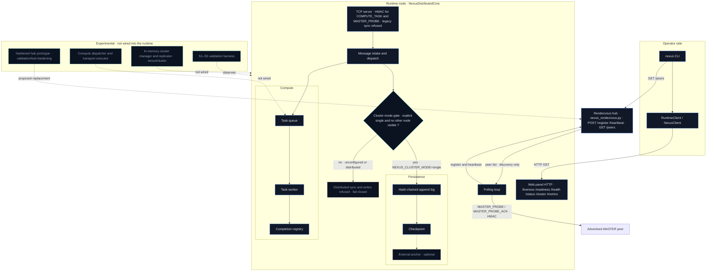
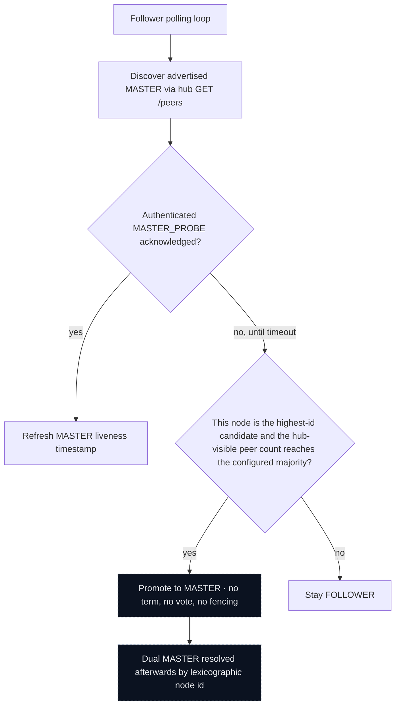
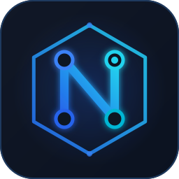

<p align="center"></p>

<p align="center"><strong>English</strong> · <a href="README.pt-BR.md">Português (Brasil)</a></p>

<p align="center">
  <a href="https://github.com/gutembergpb27/Termux-nexus/actions/workflows/ci.yml"></a>
  <a href="https://github.com/gutembergpb27/Termux-nexus/releases"></a>
  <a href="LICENSE"></a>
  
  <a href="https://github.com/gutembergpb27/Termux-nexus/actions/runs/42006263229"></a>
</p>

---

## Overview

Nexus Runtime Platform is an **experimental distributed runtime** for research
and validation of resilient computing infrastructure. It combines runtime
lifecycle management, HMAC-authenticated compute and liveness messages (the
unauthenticated legacy sync path is disabled), hash-chained
persistence, a compute task pipeline, diagnostics and observability in a
modular Python code base.

The project follows one idea: **From vision to engineering. From engineering
to evidence.** It is developed **evidence-first** — a capability is described
as implemented only when code, tests and recorded evidence support it, and
every known gap is stated explicitly.

> [!IMPORTANT]
> **Status at a glance**
> - Experimental research runtime — not production software.
> - **No distributed consensus**: no election term, vote, leader fencing or majority commit.
> - **Fail-closed by default** (W08-B, PR #104): local writes require an explicit `NEXUS_CLUSTER_MODE=single`; a missing cluster mode blocks writes, peer sync and promotion; distributed mode never writes; invalid configuration refuses to start. See the [migration guide](docs/NEXUS_V2700_W08B_CLUSTER_MODE_MIGRATION.md).
> - Latest pre-release: [`v2700.0.0-rc2`](https://github.com/gutembergpb27/Termux-nexus/releases/tag/v2700.0.0-rc2). The GitHub "Latest" release is still `v2500.0.0`; post-RC2 work on `main` is not tagged.

---

## Architecture

The diagram shows the components on `main` and how they connect. Solid
links are wired into the runtime; dashed links are experimental components
that exist in the repository but are **not** wired into the live runtime.



**How MASTER liveness and promotion work today** — and why this is not consensus:



Hub advertisement is treated as discovery, not as proof of liveness. The
"quorum" used for promotion is a count of peers in the hub's
**unauthenticated** `GET /peers` response, not a vote.

<p align="center"></p>

---

## Capability matrix

State of `main` at `9218889`.

### ✅ Implemented

| Capability | Notes |
|---|---|
| Hash-chained append log | With checkpoint and optional external anchor |
| HMAC message envelopes | TTL and replay protection; a single cluster-wide shared secret |
| Fail-closed cluster mode (QS-C01 + W08-B) | Local writes only with explicit `NEXUS_CLUSTER_MODE=single`; legacy peer sync disabled in every mode; missing configuration blocks writes, sync and promotion; invalid configuration refuses to start — not yet physically revalidated |
| Authenticated MASTER liveness probe | `MASTER_PROBE` / `MASTER_PROBE_ACK` — not yet physically revalidated |
| Compute task pipeline | Task queue, worker and completion registry |
| CLI | `version`, `doctor`, `status`, `peers`, `cluster` |
| Runtime HTTP endpoints | `/liveness`, `/readiness`, `/health`, `/status`, `/cluster`, `/metrics` |

### 🧪 Experimental

| Component | Status |
|---|---|
| S1–S5 validation harness | Validation tooling, see [`validation/s1-s5-harness`](validation/s1-s5-harness/README.md) |
| Hardened rendezvous hub prototype | Not wired into the runtime, see [`validation/hub-hardening`](validation/hub-hardening/README.md) |
| Distributed compute dispatcher / transport executor | Not wired to the live runtime |
| In-memory cluster manager / replicator | `nexus/cluster/` — in-memory only |

### ⛔ Not yet demonstrated

| Property | Status |
|---|---|
| Distributed consensus | Absent |
| Persistent election term and vote | Absent |
| Leader fencing | Absent |
| Majority commit | Absent |
| Partition safety | Not demonstrated |
| Per-node cryptographic identity / TLS | Absent |
| Data durability across leader change | Not demonstrated |
| Safe replication for N > 1 | Not demonstrated — distributed writes are blocked in every mode |

---

## Validation results

### Continuous integration

Workflow **"Nexus Runtime CI"** ([`.github/workflows/ci.yml`](.github/workflows/ci.yml)),
run [42006263229](https://github.com/gutembergpb27/Termux-nexus/actions/runs/42006263229)
on `main` at commit `9218889` — **success**. All three jobs are required
checks in the `main-protection-v2700` ruleset.

| Required check | Result |
|---|---|
| `test-and-build` (`tests/`) | 926 passed, 1 xfailed |
| `W05/W06 S1-S5 harness tests` | 107 passed (90 + 17) |
| `W07 experimental hub hardening tests` | 60 passed |
| **Total** | **1,093 passed, 1 xfailed** |

> [!NOTE]
> CI runs only on `windows-latest` with Python 3.14. `pyproject.toml`
> declares `requires-python >= 3.10`, but other versions and Linux are not
> exercised in CI. The single expected failure is `tests/test_integrity.py:411`
> (coordinated log and checkpoint rollback requires an external anchor); it is
> unrelated to consensus.

**Historical figure:** the V2700 RC2 certification baseline completed the
repository regression suite with `810 passed, 1 xfailed`. The resilience
evidence below is maintained separately from the regression count.

### Physical resilience evidence

V2700 includes a controlled three-node MASTER-loss statistical campaign
(Axis 11). The Axis 11 campaign population contains **29 physical samples
(run011–run039)**: **29 valid, 29 converged, 0 operational split-brain
observations, and 29 NODE-C promotions** under the documented experiment
contract.

| T0 -> T4 metric | Result |
| --- | ---: |
| Mean | 31492.270 ms |
| Median | 31491.374 ms |
| p95 | 31584.133 ms |
| p99 | 31607.337 ms |
| Minimum | 31367.022 ms |
| Maximum | 31614.804 ms |

`run010` is preserved as incomplete and is not counted as a physical sample.
No `run040` was created.

> [!WARNING]
> The Axis 10/11 results were measured **before** the QS-C01 fail-closed change
> and the `MASTER_PROBE` liveness check (PR #101). "0 operational split-brain
> observations" is an observation in a controlled scenario, **not a safety
> property**. These results apply to the documented experiment contract only;
> they are not production certification, a universal fault-tolerance claim, or
> a performance comparison with etcd, Consul, Raft implementations or other
> distributed systems.

Methodology, timing statistics and reproducibility details:
[Resilience Case Study](docs/NEXUS_V2700_RESILIENCE_CASE_STUDY.md) ·
[Axis 11 Statistical Resilience](docs/validation/NEXUS-V2700-AXIS-11-STATISTICAL-RESILIENCE.md) ·
[Axis 10 Quorum Timing](docs/validation/NEXUS-V2700-AXIS-10-QUORUM-TIMING.md) ·
[Windows + Android validation](docs/windows_android_validation.md).

---

## Known limitations

Status as of 2026-11-05 (`main` at `9218889`, after PR #104). Details are in
[PROJECT_STATE](docs/PROJECT_STATE.md) and the
[W08-A consensus safety audit](docs/NEXUS_V2700_W08A_CONSENSUS_SAFETY_AUDIT.md) (PR #103).

- **No distributed consensus.** There is no election term, no vote, no leader
  fencing and no majority commit.
- **Quorum is a hub-visible count.** Promotion counts the peers listed by the
  rendezvous hub's unauthenticated `GET /peers`; it is not a vote.
- **Dual MASTER is possible** under an asymmetric partition (all nodes reach
  the hub, a follower cannot reach the master). It is resolved afterwards by
  lexicographic id.
- **`single` mode is an operator assertion, not a safety mechanism.** The
  runtime cannot prove that no other node exists: the hub peer list is
  unauthenticated and an empty list proves nothing. Running `single` on more
  than one node creates independent, divergent writers. (The earlier unsafe
  `NEXUS_CLUSTER_SIZE=1` default was removed by PR #104.)
- **Log rotation loses history.** Each rotation deletes the previously rotated
  file.
- **Axis 10/11 predate QS-C01.** See the warning above.
- **Network hardening is incomplete.** The core TCP server lacks accept-side
  timeouts; the web panel is unauthenticated and binds `0.0.0.0`.
- **Release status.** The GitHub "Latest" release is still `v2500.0.0`;
  `v2700.0.0-rc2` is a pre-release. Post-RC2 work (PR #101, PR #102) is on
  `main` but not tagged.

---

## Quick start

These steps install the package and run the test suite locally. They do
**not** describe a multi-node deployment.

### Requirements

- Python 3.14 (the only version validated in CI; `pyproject.toml` declares `>= 3.10`)
- Git
- PowerShell, Bash or Termux

### Clone and install

```bash
git clone https://github.com/gutembergpb27/Termux-nexus.git
cd Termux-nexus
```

Windows PowerShell:

```powershell
python -m venv .venv
.venv\Scripts\Activate.ps1
```

Linux or Termux:

```bash
python -m venv .venv
source .venv/bin/activate
```

Install for development (the package has no runtime dependencies; `pytest`
is installed separately, as in CI):

```bash
python -m pip install --upgrade pip pytest
python -m pip install -e .
```

### Validate the installation

```bash
python -m pytest -q
nexus version
nexus doctor
```

### Safety notes

- Do not expose the rendezvous hub (port 8500), the web panel or the core TCP
  port beyond a trusted network. The web panel is unauthenticated and the
  servers bind `0.0.0.0`.
- `NEXUS_SECRET_KEY` must be set for the runtime and kept private; it is a
  single shared secret for the whole cluster.
- Do not run multi-node deployments expecting safe replicated writes. There is
  no consensus, and distributed writes are blocked in every mode.
- Without `NEXUS_CLUSTER_MODE` a node starts fail-closed (no writes, no peer
  sync, no promotion). Set `NEXUS_CLUSTER_MODE=single` only on a node that is
  truly alone; read the [migration guide](docs/NEXUS_V2700_W08B_CLUSTER_MODE_MIGRATION.md) first.

---

## Command-line interface

```text
usage: nexus [-h] {version,status,peers,cluster,doctor} ...

Nexus Runtime Platform CLI
```

| Command | Purpose | Default target |
|---|---|---|
| `nexus version` | Display the installed platform version | — |
| `nexus doctor` | Diagnose the local environment or a remote runtime | local; `--url` optional |
| `nexus status` | Query the state of a Nexus node | `http://127.0.0.1:8081/status` |
| `nexus peers` | List peers registered in the hub | `http://127.0.0.1:8500/peers` |
| `nexus cluster` | Display the cluster summary | `http://127.0.0.1:8081/cluster` |

```powershell
nexus version                                   # Nexus Runtime Platform v2700.0.0rc2
nexus doctor                                    # local diagnostics
nexus doctor --url http://127.0.0.1:8081/status # remote runtime diagnostics
nexus doctor --json                             # JSON output (also: status, cluster, peers)
nexus doctor --url http://127.0.0.1:8081/status --watch --interval 2 --clear
```

`nexus doctor` reports CLI and Python versions, operating system, Python
executable, working-directory permissions and — when a runtime URL is given —
runtime connectivity, health, storage integrity, and cluster leadership and
membership.

---

## Runtime endpoints

Web panel served by each runtime node (`web_panel.py`, HTTP `GET`, JSON):

| Endpoint | Purpose |
|---|---|
| `/liveness` | Process liveness and node id |
| `/readiness` | Readiness report (`503` when not ready) |
| `/health` | Runtime and storage-integrity health (`503` when unhealthy) |
| `/status` | Node identity, role, ports and persistence summary |
| `/cluster` | Leader, followers and peer membership as seen by the node |
| `/metrics` | Role, log height, tip hash and a `term` field (always `0`; no election term exists) |

Rendezvous hub (`nexus_rendezvous.py`, port 8500):

| Endpoint | Purpose |
|---|---|
| `POST /register` | HMAC-authenticated peer registration |
| `POST /heartbeat` | HMAC-authenticated peer heartbeat |
| `GET /peers` | Active peer list — **unauthenticated**, discovery only |

```powershell
nexus status  --url http://127.0.0.1:8081/status
nexus cluster --url http://127.0.0.1:8081/cluster
nexus peers   --url http://127.0.0.1:8500/peers
```

---

## Package structure

```text
nexus/                      # installable package (CLI entry: nexus = nexus.cli:main)
├── cli.py · client.py · exceptions.py · __main__.py
├── runtime_client.py · runtime_lifecycle.py · runtime_observability.py
├── commands/               # version, doctor, status, peers, cluster
├── cluster/                # manager, orchestrator, replicator (in-memory, experimental)
├── compute/                # task queue/worker/completion, scheduler, dispatcher,
│                           # transport executor, capabilities, retry, metrics, ...
└── runtime/                # config, engine, state, events, health, readiness,
                            # diagnostics, cluster, logger, metrics, telemetry, tracing

nexus_distributed_core.py   # NexusDistributedCore: polling loop, TCP server, QS-C01, MASTER_PROBE
nexus_protocol.py           # HMAC envelopes, TTL, replay cache
nexus_transport.py          # node-to-node transport
nexus_rendezvous.py         # rendezvous hub (discovery)
persistence.py              # hash-chained log and checkpoint
web_panel.py                # runtime HTTP endpoints
tests/                      # regression suite (test-and-build)
validation/                 # S1–S5 harness, hub hardening and physical campaign evidence
docs/                       # technical documentation
```

---

## Documentation

| Document | Purpose |
| --- | --- |
| [Executive Technical Brief](docs/NEXUS_V2700_EXECUTIVE_TECHNICAL_BRIEF.md) | External technical overview |
| [External Evaluation Guide](docs/NEXUS_V2700_EXTERNAL_EVALUATION_GUIDE.md) | Guide for external evaluators |
| [External Reproduction Protocol](docs/NEXUS_V2700_EXTERNAL_REPRODUCTION_PROTOCOL.md) | Reproduction procedure |
| [External Resilience Demonstration](docs/NEXUS_V2700_EXTERNAL_RESILIENCE_DEMO.md) | Entry point to resilience evidence |
| [Resilience Case Study](docs/NEXUS_V2700_RESILIENCE_CASE_STUDY.md) | Controlled MASTER-loss case study |
| [Technical Positioning](docs/NEXUS_V2700_TECHNICAL_POSITIONING.md) | Scope and neutral technology positioning |
| [Security Trust Boundary](docs/NEXUS_V2700_SECURITY_TRUST_BOUNDARY.md) | Security and trust boundaries |
| [Distributed Commit Contract](docs/NEXUS_V2700_DISTRIBUTED_COMMIT_CONTRACT.md) | Distributed commit contract |
| [V2700 Architecture Plan](docs/NEXUS_V2700_ARCHITECTURE_PLAN.md) | Architecture and development axes |
| [Project State](docs/PROJECT_STATE.md) | Current project state |
| [Axis 10 Quorum Timing](docs/validation/NEXUS-V2700-AXIS-10-QUORUM-TIMING.md) | Quorum timing validation |
| [Axis 11 Statistical Resilience](docs/validation/NEXUS-V2700-AXIS-11-STATISTICAL-RESILIENCE.md) | Statistical resilience record |
| [Windows + Android validation](docs/windows_android_validation.md) | Physical multi-device validation |
| [S1–S5 harness](validation/s1-s5-harness/README.md) | W05/W06 validation harness |
| [Hub hardening](validation/hub-hardening/README.md) | W07 experimental hub prototype |
| [V2700 RC2 Release Notes](RELEASE_NOTES_v2700.0.0-rc2.md) | Release-candidate record |
| [v2500 architecture map](docs/NEXUS_V2500_ARCHITECTURE_MAP.md) | Historical architecture reference |
| [W08-A Consensus Safety Audit](docs/NEXUS_V2700_W08A_CONSENSUS_SAFETY_AUDIT.md) | Read-only audit of the authority, quorum and fencing code (findings F1–F10, invariants INV-01..INV-07) |
| [W08-B Cluster Mode Migration](docs/NEXUS_V2700_W08B_CLUSTER_MODE_MIGRATION.md) | `NEXUS_CLUSTER_MODE` behavior, limits of `single`, migration and affected launchers |

### External evaluation path

1. [Executive Technical Brief](docs/NEXUS_V2700_EXECUTIVE_TECHNICAL_BRIEF.md) — architecture, capabilities, boundaries and evidence map.
2. [Resilience Case Study](docs/NEXUS_V2700_RESILIENCE_CASE_STUDY.md) — controlled three-node MASTER-loss scenario.
3. [Technical Positioning](docs/NEXUS_V2700_TECHNICAL_POSITIONING.md) — neutral scope comparison with established distributed-system technologies.
4. [External Resilience Demonstration](docs/NEXUS_V2700_EXTERNAL_RESILIENCE_DEMO.md) — navigation layer over the resilience evidence.
5. [Axis 11 Statistical Resilience](docs/validation/NEXUS-V2700-AXIS-11-STATISTICAL-RESILIENCE.md) — statistical record and methodology.
6. [Known limitations](#known-limitations) — read before drawing conclusions.

---

## Release status

The current public pre-release is
[**v2700.0.0-rc2**](https://github.com/gutembergpb27/Termux-nexus/releases/tag/v2700.0.0-rc2)
([release notes](RELEASE_NOTES_v2700.0.0-rc2.md)). V2700 consolidates durable
execution semantics, compute coordination, operational readiness and
observability, and authenticated transport with replay protection. The GitHub
"Latest" release remains `v2500.0.0`. The project remains experimental;
published evidence supports the documented contracts and scenarios and is not
a production-readiness certification.

---

## Evolution history

Selected milestones from the repository tags and merged pull requests.

| Date | Milestone |
|---|---|
| 2026-07-07 | `v1900` |
| 2026-07-08 | `v1950`, `v2000`, `v2100-catchup`, `v2100-failover` |
| 2026-07-11 | `runtime-v1-beta`, `runtime-v1.1-rc1` |
| 2026-07-16 | `v2300-alpha1` |
| 2026-07-19 | `v2300.0.0a1` |
| 2026-07-23 | `v2400.0.0` |
| 2026-07-25 | `v2500.0.0-rc1` |
| 2026-07-29 | `v2500.0.0-rc2` … `rc4`, `v2500.0.0` (current GitHub "Latest") |
| 2026-08-19 | `v2600.0.0-alpha.1` |
| 2026-08-28 | `v2700.0.0-rc1` |
| 2026-08-31 | `nirt-01-external-candidate` |
| 2026-09-02 | `nirt-02-audited-integration` |
| 2026-09-17 | `v2700.0.0-rc2` (pre-release) |
| 2026-11-04 | PR #101 — QS-C01 fail-closed gate and MASTER liveness probe (on `main`, untagged) |
| 2026-11-04 | PR #102 — W05–W07 validation harness and experimental hub hardening (on `main`, untagged) |
| 2026-11-05 | PR #103 — W08-A consensus safety audit and post-RC2 status (documentation) |
| 2026-11-05 | PR #104 — W08-B explicit fail-closed cluster mode |
| 2026-11-05 | PR #105 — W09 bilingual presentation and brand identity |

Release focus, as recorded in the original roadmap: early versions —
persistence and runtime experiments; v2200 — distributed nodes and rendezvous
hub; v2300 — operational CLI and diagnostics; v2400 — runtime integration and
observability; v2500 RC1 — unified runtime and cluster architecture; v2600
Alpha 1 — compute lifecycle, durable state and startup recovery; v2700 RC1 —
durable execution, coordination, readiness and transport hardening.

---

## Roadmap

W08-B sequence, in order, with no dates promised. **Distributed writes stay
blocked until the corresponding invariants are demonstrated.**

- [x] Explicit fail-closed cluster mode (`NEXUS_CLUSTER_MODE=single|distributed`) — PR #104
- [ ] Log persistence without history loss
- [ ] Quarantine of stale runtime copies
- [ ] TCP timeouts and concurrency fixes
- [ ] Test hygiene and Linux CI
- [ ] Persistent election term and vote
- [ ] Pure authority state machine and deterministic partition simulator
- [ ] Term in log blocks and stale-leader rejection
- [ ] Signed node-to-node messages; hub as discovery only
- [ ] Experimental integration behind a default-off flag

Beyond W08-B (unscheduled): TLS and per-node identity (HMAC envelope
authentication already exists), expanded multi-node and network-failure
testing, packaged releases, additional operating-system validation and formal
production-readiness criteria.

---

## Project principles

1. Evidence before claims.
2. Explicit technical limitations.
3. Reproducible validation.
4. Modular architecture.
5. Runtime observability.
6. Integrity-aware state management.
7. Incremental evolution with preserved history.

## Contributing

Issues and pull requests are welcome through GitHub. Changes to `main` go
through pull requests, and the three CI checks above are required to pass.
See [CONTRIBUTING.md](CONTRIBUTING.md).

## License

Released under the [MIT License](LICENSE).

## Creator

Created and maintained by **Gutemberg Procópio Barbosa** ([@gutembergpb27](https://github.com/gutembergpb27)).

---

<p align="center"></p>
<p align="center"><strong>Nexus Runtime Platform</strong><br><em>From vision to engineering. From engineering to evidence.</em></p>
<p align="center"><strong>English</strong> · <a href="README.pt-BR.md">Português (Brasil)</a></p>
