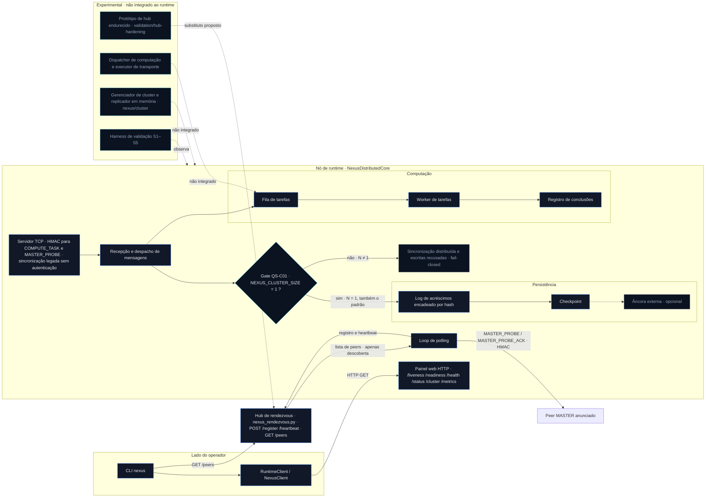
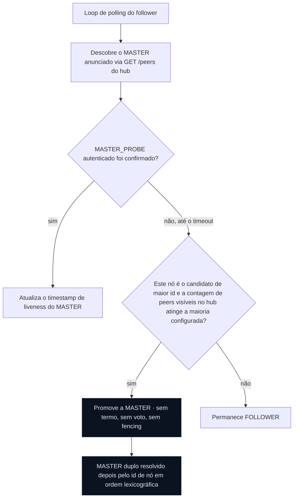
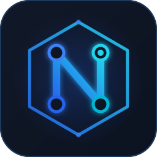

<p align="center"></p>

<p align="center"><a href="README.md">English</a> · <strong>Português (Brasil)</strong></p>

<p align="center">
  <a href="https://github.com/gutembergpb27/Termux-nexus/actions/workflows/ci.yml"></a>
  <a href="https://github.com/gutembergpb27/Termux-nexus/releases"></a>
  <a href="LICENSE"></a>
  
  <a href="https://github.com/gutembergpb27/Termux-nexus/actions/runs/41912549086"></a>
</p>

---

## Visão geral

Nexus Runtime Platform é um **runtime distribuído experimental** para pesquisa
e validação de infraestrutura computacional resiliente. Ele combina
gerenciamento do ciclo de vida do runtime, mensagens de computação e liveness
autenticadas por HMAC (o caminho de sincronização legado não é autenticado),
persistência encadeada por hash, um pipeline de tarefas de computação,
diagnóstico e observabilidade em uma base de código Python modular.

O projeto segue uma ideia: **From vision to engineering. From engineering
to evidence.** — *Da visão à engenharia. Da engenharia à evidência.* Ele é
desenvolvido com **evidência em primeiro lugar** — uma capacidade só é descrita
como implementada quando código, testes e evidências registradas a sustentam, e
toda lacuna conhecida é declarada explicitamente.

> [!IMPORTANT]
> **Status em resumo**
> - Runtime experimental de pesquisa — não é software de produção.
> - **Sem consenso distribuído**: não há termo de eleição, voto, fencing de líder nem commit por maioria.
> - Escritas multinó são **bloqueadas por projeto** quando `NEXUS_CLUSTER_SIZE ≠ 1` (gate fail-closed QS-C01). Na `main` a variável tem padrão `1`, o que deixa esse gate desligado — veja [Limitações conhecidas](#limitações-conhecidas); um modo de cluster explícito está preparado, mas ainda não está na `main` (W08-B).
> - Pré-release mais recente: [`v2700.0.0-rc2`](https://github.com/gutembergpb27/Termux-nexus/releases/tag/v2700.0.0-rc2). A release "Latest" do GitHub ainda é a `v2500.0.0`; o trabalho pós-RC2 na `main` não possui tag.

---

## Arquitetura

O diagrama mostra os componentes na `main` e como eles se conectam. Ligações
contínuas estão integradas ao runtime; ligações tracejadas são componentes
experimentais que existem no repositório, mas **não** estão integrados ao
runtime em execução.



**Como a verificação de vida (liveness) e a promoção do MASTER funcionam hoje** — e por que isso não é consenso:



O anúncio no hub é tratado como descoberta, não como prova de liveness. O
"quórum" usado para a promoção é uma contagem de peers na resposta
**não autenticada** de `GET /peers` do hub, não um voto.

<p align="center"></p>

---

## Matriz de capacidades

Estado da `main` em `dc180e4`.

### ✅ Implementado

| Capacidade | Observações |
|---|---|
| Log de acréscimos encadeado por hash | Com checkpoint e âncora externa opcional |
| Envelopes de mensagem HMAC | TTL e proteção contra replay; um único segredo compartilhado por todo o cluster |
| Gate fail-closed QS-C01 | Bloqueia sincronização distribuída e escritas quando `NEXUS_CLUSTER_SIZE ≠ 1` — ainda não revalidado fisicamente |
| Sonda autenticada de liveness do MASTER | `MASTER_PROBE` / `MASTER_PROBE_ACK` — ainda não revalidada fisicamente |
| Pipeline de tarefas de computação | Fila de tarefas, worker e registro de conclusões |
| CLI | `version`, `doctor`, `status`, `peers`, `cluster` |
| Endpoints HTTP do runtime | `/liveness`, `/readiness`, `/health`, `/status`, `/cluster`, `/metrics` |

### 🧪 Experimental

| Componente | Status |
|---|---|
| Harness de validação S1–S5 | Ferramental de validação, ver [`validation/s1-s5-harness`](validation/s1-s5-harness/README.md) |
| Protótipo de hub de rendezvous endurecido | Não integrado ao runtime, ver [`validation/hub-hardening`](validation/hub-hardening/README.md) |
| Dispatcher de computação distribuída / executor de transporte | Não integrado ao runtime em execução |
| Gerenciador de cluster / replicador em memória | `nexus/cluster/` — apenas em memória |

### ⛔ Ainda não demonstrado

| Propriedade | Status |
|---|---|
| Consenso distribuído | Ausente |
| Termo de eleição e voto persistentes | Ausente |
| Fencing de líder | Ausente |
| Commit por maioria | Ausente |
| Segurança sob partição | Não demonstrada |
| Identidade criptográfica por nó / TLS | Ausente |
| Durabilidade dos dados na troca de líder | Não demonstrada |
| Replicação segura para N > 1 | Não demonstrada — escritas bloqueadas pelo QS-C01 apenas quando `NEXUS_CLUSTER_SIZE` é definida como N |

---

## Resultados de validação

### Integração contínua

Workflow **"Nexus Runtime CI"** ([`.github/workflows/ci.yml`](.github/workflows/ci.yml)),
execução [41912549086](https://github.com/gutembergpb27/Termux-nexus/actions/runs/41912549086)
na `main` no commit `dc180e4` — **sucesso**. Os três jobs são checks
obrigatórios no ruleset `main-protection-v2700`.

| Check obrigatório | Resultado |
|---|---|
| `test-and-build` (`tests/`) | 858 aprovados, 1 xfailed |
| `W05/W06 S1-S5 harness tests` | 107 aprovados (90 + 17) |
| `W07 experimental hub hardening tests` | 60 aprovados |
| **Total** | **1.025 aprovados, 1 xfailed** |

> [!NOTE]
> A CI roda apenas em `windows-latest` com Python 3.14. O `pyproject.toml`
> declara `requires-python >= 3.10`, mas outras versões e Linux não são
> exercitados na CI. A única falha esperada é `tests/test_integrity.py:411`
> (o rollback coordenado de log e checkpoint requer uma âncora externa); ela
> não tem relação com consenso.

**Número histórico:** a linha de base de certificação V2700 RC2 concluiu a
suíte de regressão do repositório com `810 passed, 1 xfailed`. As evidências de
resiliência abaixo são mantidas separadamente da contagem de regressão.

### Evidências físicas de resiliência

A V2700 inclui uma campanha estatística controlada de perda do MASTER em três
nós (Eixo 11). A população da campanha do Eixo 11 contém **29 amostras físicas
(run011–run039)**: **29 válidas, 29 convergidas, 0 observações de split-brain
operacional e 29 promoções do NODE-C** sob o contrato de experimento
documentado.

| Métrica T0 -> T4 | Resultado |
| --- | ---: |
| Média | 31492.270 ms |
| Mediana | 31491.374 ms |
| p95 | 31584.133 ms |
| p99 | 31607.337 ms |
| Mínimo | 31367.022 ms |
| Máximo | 31614.804 ms |

`run010` é preservado como incompleto e não é contado como amostra física.
Nenhum `run040` foi criado.

> [!WARNING]
> Os resultados dos Eixos 10/11 foram medidos **antes** da mudança fail-closed
> QS-C01 e da verificação de liveness `MASTER_PROBE` (PR #101). "0 observações
> de split-brain operacional" é uma observação em um cenário controlado, **não
> uma propriedade de segurança**. Esses resultados se aplicam apenas ao contrato
> de experimento documentado; não constituem certificação de produção, uma
> alegação universal de tolerância a falhas nem uma comparação de desempenho com
> etcd, Consul, implementações de Raft ou outros sistemas distribuídos.

Metodologia, estatísticas de tempo e detalhes de reprodutibilidade:
[Estudo de caso de resiliência](docs/NEXUS_V2700_RESILIENCE_CASE_STUDY.md) ·
[Eixo 11 — Resiliência estatística](docs/validation/NEXUS-V2700-AXIS-11-STATISTICAL-RESILIENCE.md) ·
[Eixo 10 — Temporização de quórum](docs/validation/NEXUS-V2700-AXIS-10-QUORUM-TIMING.md) ·
[Validação Windows + Android](docs/windows_android_validation.md).

---

## Limitações conhecidas

Status em 2026-11-04 (`main` em `dc180e4`). Os detalhes estão em
[PROJECT_STATE](docs/PROJECT_STATE.md) e, após o merge, na auditoria de
segurança de consenso W08-A (PR-A pendente).

- **Sem consenso distribuído.** Não há termo de eleição, voto, fencing de
  líder nem commit por maioria.
- **O quórum é uma contagem visível no hub.** A promoção conta os peers
  listados pelo `GET /peers` não autenticado do hub de rendezvous; não é um voto.
- **MASTER duplo é possível** sob uma partição assimétrica (todos os nós
  alcançam o hub, um follower não alcança o master). Ele é resolvido depois
  pelo id em ordem lexicográfica.
- **`NEXUS_CLUSTER_SIZE` tem `1` como padrão.** Uma implantação multinó que não
  o defina roda com escritas locais e o caminho legado de sincronização não
  autenticado habilitados; o bloqueio QS-C01 para N ≠ 1 não se aplica. Um modo
  de cluster fail-closed explícito (`NEXUS_CLUSTER_MODE`) está preparado em um
  pull request separado (W08-B) e **ainda não está na `main`**.
- **A rotação de log perde histórico.** Cada rotação apaga o arquivo
  rotacionado anteriormente.
- **Os Eixos 10/11 são anteriores ao QS-C01.** Veja o aviso acima.
- **O endurecimento de rede está incompleto.** O servidor TCP do núcleo não tem
  timeouts no lado do accept; o painel web não é autenticado e faz bind em
  `0.0.0.0`.
- **Status de release.** A release "Latest" do GitHub ainda é a `v2500.0.0`;
  `v2700.0.0-rc2` é uma pré-release. O trabalho pós-RC2 (PR #101, PR #102) está
  na `main`, mas sem tag.

---

## Início rápido

Estes passos instalam o pacote e executam a suíte de testes localmente. Eles
**não** descrevem uma implantação multinó.

### Requisitos

- Python 3.14 (a única versão validada na CI; o `pyproject.toml` declara `>= 3.10`)
- Git
- PowerShell, Bash ou Termux

### Clonar e instalar

```bash
git clone https://github.com/gutembergpb27/Termux-nexus.git
cd Termux-nexus
```

Windows PowerShell:

```powershell
python -m venv .venv
.venv\Scripts\Activate.ps1
```

Linux ou Termux:

```bash
python -m venv .venv
source .venv/bin/activate
```

Instalação para desenvolvimento (o pacote não tem dependências de runtime; o
`pytest` é instalado separadamente, como na CI):

```bash
python -m pip install --upgrade pip pytest
python -m pip install -e .
```

### Validar a instalação

```bash
python -m pytest -q
nexus version
nexus doctor
```

### Notas de segurança

- Não exponha o hub de rendezvous (porta 8500), o painel web nem a porta TCP do
  núcleo além de uma rede confiável. O painel web não é autenticado e os
  servidores fazem bind em `0.0.0.0`.
- `NEXUS_SECRET_KEY` deve ser definida para o runtime e mantida privada; é um
  único segredo compartilhado por todo o cluster.
- Não execute implantações multinó esperando escritas replicadas seguras. Não
  há consenso. As escritas só são bloqueadas quando `NEXUS_CLUSTER_SIZE` é
  definida com o número real de nós (N ≠ 1).
- `NEXUS_CLUSTER_SIZE` não definida assume o padrão `1`: mesmo com vários nós
  em execução, as escritas locais e a sincronização legada sem autenticação
  continuam habilitadas. Defina-a com o número real de nós para falhar de forma
  segura. Um modo de cluster fail-closed explícito está pendente (W08-B).

---

## Interface de linha de comando

```text
usage: nexus [-h] {version,status,peers,cluster,doctor} ...

Nexus Runtime Platform CLI
```

| Comando | Finalidade | Alvo padrão |
|---|---|---|
| `nexus version` | Exibe a versão instalada da plataforma | — |
| `nexus doctor` | Diagnostica o ambiente local ou um runtime remoto | local; `--url` opcional |
| `nexus status` | Consulta o estado de um nó Nexus | `http://127.0.0.1:8081/status` |
| `nexus peers` | Lista os peers registrados no hub | `http://127.0.0.1:8500/peers` |
| `nexus cluster` | Exibe o resumo do cluster | `http://127.0.0.1:8081/cluster` |

```powershell
nexus version                                   # Nexus Runtime Platform v2700.0.0rc2
nexus doctor                                    # local diagnostics
nexus doctor --url http://127.0.0.1:8081/status # remote runtime diagnostics
nexus doctor --json                             # JSON output (also: status, cluster, peers)
nexus doctor --url http://127.0.0.1:8081/status --watch --interval 2 --clear
```

O `nexus doctor` informa as versões da CLI e do Python, o sistema operacional, o
executável Python, as permissões do diretório de trabalho e — quando uma URL de
runtime é fornecida — a conectividade com o runtime, a saúde, a integridade do
armazenamento e a liderança e a composição do cluster.

---

## Endpoints do runtime

Painel web servido por cada nó de runtime (`web_panel.py`, HTTP `GET`, JSON):

| Endpoint | Finalidade |
|---|---|
| `/liveness` | Liveness do processo e id do nó |
| `/readiness` | Relatório de prontidão (`503` quando não está pronto) |
| `/health` | Saúde do runtime e da integridade do armazenamento (`503` quando não saudável) |
| `/status` | Identidade do nó, papel, portas e resumo da persistência |
| `/cluster` | Líder, followers e composição de peers conforme vistos pelo nó |
| `/metrics` | Papel, altura do log, hash da ponta e um campo `term` (sempre `0`; não existe termo de eleição) |

Hub de rendezvous (`nexus_rendezvous.py`, porta 8500):

| Endpoint | Finalidade |
|---|---|
| `POST /register` | Registro de peer autenticado por HMAC |
| `POST /heartbeat` | Heartbeat de peer autenticado por HMAC |
| `GET /peers` | Lista de peers ativos — **não autenticada**, apenas descoberta |

```powershell
nexus status  --url http://127.0.0.1:8081/status
nexus cluster --url http://127.0.0.1:8081/cluster
nexus peers   --url http://127.0.0.1:8500/peers
```

---

## Estrutura do pacote

```text
nexus/                      # installable package (CLI entry: nexus = nexus.cli:main)
├── cli.py · client.py · exceptions.py · __main__.py
├── runtime_client.py · runtime_lifecycle.py · runtime_observability.py
├── commands/               # version, doctor, status, peers, cluster
├── cluster/                # manager, orchestrator, replicator (in-memory, experimental)
├── compute/                # task queue/worker/completion, scheduler, dispatcher,
│                           # transport executor, capabilities, retry, metrics, ...
└── runtime/                # config, engine, state, events, health, readiness,
                            # diagnostics, cluster, logger, metrics, telemetry, tracing

nexus_distributed_core.py   # NexusDistributedCore: polling loop, TCP server, QS-C01, MASTER_PROBE
nexus_protocol.py           # HMAC envelopes, TTL, replay cache
nexus_transport.py          # node-to-node transport
nexus_rendezvous.py         # rendezvous hub (discovery)
persistence.py              # hash-chained log and checkpoint
web_panel.py                # runtime HTTP endpoints
tests/                      # regression suite (test-and-build)
validation/                 # S1–S5 harness, hub hardening and physical campaign evidence
docs/                       # technical documentation
```

---

## Documentação

| Documento | Finalidade |
| --- | --- |
| [Executive Technical Brief](docs/NEXUS_V2700_EXECUTIVE_TECHNICAL_BRIEF.md) | Visão técnica geral para público externo |
| [External Evaluation Guide](docs/NEXUS_V2700_EXTERNAL_EVALUATION_GUIDE.md) | Guia para avaliadores externos |
| [External Reproduction Protocol](docs/NEXUS_V2700_EXTERNAL_REPRODUCTION_PROTOCOL.md) | Procedimento de reprodução |
| [External Resilience Demonstration](docs/NEXUS_V2700_EXTERNAL_RESILIENCE_DEMO.md) | Ponto de entrada para as evidências de resiliência |
| [Resilience Case Study](docs/NEXUS_V2700_RESILIENCE_CASE_STUDY.md) | Estudo de caso controlado de perda do MASTER |
| [Technical Positioning](docs/NEXUS_V2700_TECHNICAL_POSITIONING.md) | Escopo e posicionamento tecnológico neutro |
| [Security Trust Boundary](docs/NEXUS_V2700_SECURITY_TRUST_BOUNDARY.md) | Fronteiras de segurança e de confiança |
| [Distributed Commit Contract](docs/NEXUS_V2700_DISTRIBUTED_COMMIT_CONTRACT.md) | Contrato de commit distribuído |
| [V2700 Architecture Plan](docs/NEXUS_V2700_ARCHITECTURE_PLAN.md) | Arquitetura e eixos de desenvolvimento |
| [Project State](docs/PROJECT_STATE.md) | Estado atual do projeto |
| [Axis 10 Quorum Timing](docs/validation/NEXUS-V2700-AXIS-10-QUORUM-TIMING.md) | Validação da temporização de quórum |
| [Axis 11 Statistical Resilience](docs/validation/NEXUS-V2700-AXIS-11-STATISTICAL-RESILIENCE.md) | Registro de resiliência estatística |
| [Windows + Android validation](docs/windows_android_validation.md) | Validação física com múltiplos dispositivos |
| [S1–S5 harness](validation/s1-s5-harness/README.md) | Harness de validação W05/W06 |
| [Hub hardening](validation/hub-hardening/README.md) | Protótipo experimental de hub W07 |
| [V2700 RC2 Release Notes](RELEASE_NOTES_v2700.0.0-rc2.md) | Registro da release candidate |
| [v2500 architecture map](docs/NEXUS_V2500_ARCHITECTURE_MAP.md) | Referência histórica de arquitetura |
| Auditoria de segurança de consenso W08-A — `docs/NEXUS_V2700_W08A_CONSENSUS_SAFETY_AUDIT.md` | **Preparado, ainda fora da `main` (PR-A)** |

### Roteiro de avaliação externa

1. [Executive Technical Brief](docs/NEXUS_V2700_EXECUTIVE_TECHNICAL_BRIEF.md) — arquitetura, capacidades, fronteiras e mapa de evidências.
2. [Resilience Case Study](docs/NEXUS_V2700_RESILIENCE_CASE_STUDY.md) — cenário controlado de perda do MASTER em três nós.
3. [Technical Positioning](docs/NEXUS_V2700_TECHNICAL_POSITIONING.md) — comparação neutra de escopo com tecnologias consolidadas de sistemas distribuídos.
4. [External Resilience Demonstration](docs/NEXUS_V2700_EXTERNAL_RESILIENCE_DEMO.md) — camada de navegação sobre as evidências de resiliência.
5. [Axis 11 Statistical Resilience](docs/validation/NEXUS-V2700-AXIS-11-STATISTICAL-RESILIENCE.md) — registro estatístico e metodologia.
6. [Limitações conhecidas](#limitações-conhecidas) — leia antes de tirar conclusões.

---

## Status de release

A pré-release pública atual é a
[**v2700.0.0-rc2**](https://github.com/gutembergpb27/Termux-nexus/releases/tag/v2700.0.0-rc2)
([notas de release](RELEASE_NOTES_v2700.0.0-rc2.md)). A V2700 consolida
semântica de execução durável, coordenação de computação, prontidão operacional
e observabilidade, e transporte autenticado com proteção contra replay. A
release "Latest" do GitHub continua sendo a `v2500.0.0`. O projeto permanece
experimental; as evidências publicadas sustentam os contratos e cenários
documentados e não constituem uma certificação de prontidão para produção.

---

## Histórico de evolução

Marcos selecionados a partir das tags do repositório e dos pull requests integrados.

| Data | Marco |
|---|---|
| 2026-07-07 | `v1900` |
| 2026-07-08 | `v1950`, `v2000`, `v2100-catchup`, `v2100-failover` |
| 2026-07-11 | `runtime-v1-beta`, `runtime-v1.1-rc1` |
| 2026-07-16 | `v2300-alpha1` |
| 2026-07-19 | `v2300.0.0a1` |
| 2026-07-23 | `v2400.0.0` |
| 2026-07-25 | `v2500.0.0-rc1` |
| 2026-07-29 | `v2500.0.0-rc2` … `rc4`, `v2500.0.0` ("Latest" atual do GitHub) |
| 2026-08-19 | `v2600.0.0-alpha.1` |
| 2026-08-28 | `v2700.0.0-rc1` |
| 2026-08-31 | `nirt-01-external-candidate` |
| 2026-09-02 | `nirt-02-audited-integration` |
| 2026-09-17 | `v2700.0.0-rc2` (pré-release) |
| 2026-11-04 | PR #101 — gate fail-closed QS-C01 e sonda de liveness do MASTER (na `main`, sem tag) |
| 2026-11-04 | PR #102 — harness de validação W05–W07 e endurecimento experimental do hub (na `main`, sem tag) |
| pendente | Auditoria de segurança de consenso W08-A (PR-A) · modo de cluster fail-closed explícito W08-B (PR-B) |

Foco das versões, conforme registrado no roadmap original: versões iniciais —
experimentos de persistência e runtime; v2200 — nós distribuídos e hub de
rendezvous; v2300 — CLI operacional e diagnóstico; v2400 — integração do runtime
e observabilidade; v2500 RC1 — arquitetura unificada de runtime e cluster; v2600
Alpha 1 — ciclo de vida de computação, estado durável e recuperação na
inicialização; v2700 RC1 — execução durável, coordenação, prontidão e
endurecimento do transporte.

---

## Roadmap

Sequência W08-B, em ordem, sem datas prometidas. **As escritas distribuídas
permanecem bloqueadas até que os invariantes correspondentes sejam
demonstrados.**

- [ ] Modo de cluster fail-closed explícito (`NEXUS_CLUSTER_MODE=single|distributed`)
- [ ] Persistência de log sem perda de histórico
- [ ] Quarentena de cópias obsoletas do runtime
- [ ] Timeouts TCP e correções de concorrência
- [ ] Higiene de testes e CI em Linux
- [ ] Termo de eleição e voto persistentes
- [ ] Máquina de estados de autoridade pura e simulador determinístico de partições
- [ ] Termo nos blocos de log e rejeição de líder obsoleto
- [ ] Mensagens assinadas entre nós; hub apenas para descoberta
- [ ] Integração experimental atrás de uma flag desativada por padrão

Além da W08-B (sem cronograma): TLS e identidade por nó (a autenticação de
envelopes por HMAC já existe), testes multinó e de falhas de rede ampliados,
releases empacotadas, validação em outros sistemas operacionais e critérios
formais de prontidão para produção.

---

## Princípios do projeto

1. Evidência antes de alegações.
2. Limitações técnicas explícitas.
3. Validação reproduzível.
4. Arquitetura modular.
5. Observabilidade do runtime.
6. Gerenciamento de estado com consciência de integridade.
7. Evolução incremental com histórico preservado.

## Contribuição

Issues e pull requests são bem-vindos pelo GitHub. Alterações na `main` passam
por pull requests, e os três checks de CI acima precisam passar.
Veja [CONTRIBUTING.md](CONTRIBUTING.md).

## Licença

Distribuído sob a [Licença MIT](LICENSE).

## Criador

Criado e mantido por **Gutemberg Procópio Barbosa** ([@gutembergpb27](https://github.com/gutembergpb27)).

---

<p align="center"></p>
<p align="center"><strong>Nexus Runtime Platform</strong><br><em>From vision to engineering. From engineering to evidence.</em><br>Da visão à engenharia. Da engenharia à evidência.</p>
<p align="center"><a href="README.md">English</a> · <strong>Português (Brasil)</strong></p>
