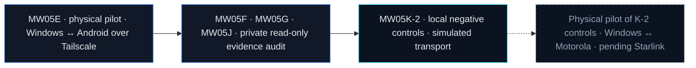

# Nexus Runtime Platform V2700

## Multi-WAN 05 series — MW05E, MW05F, MW05G, MW05J and MW05K-2 (experimental)

**English** · [Português (Brasil)](NEXUS_V2700_MULTIWAN_05_SERIES_PT.md)

**Reference date:** November 23, 2026

**Classification:** public experimental documentation; raw evidence retained privately.

**Status:** physical remote compute pilot executed (MW05E); private post-pilot
evidence audit reported (MW05F, MW05G, MW05J); local negative-control suite
with simulated transport reported as passing (MW05K-2). **A new physical
Windows–Motorola pilot of the MW05K-2 controls is pending** until the Starlink
connection is available.

> [!IMPORTANT]
> **Scope.** These milestones concern isolated laboratory tools around the
> Nexus compute path. They do **not** demonstrate distributed consensus,
> certified exactly-once execution, universal partition tolerance, leader
> fencing, distributed commit or production readiness. Nothing in this series
> changes the runtime on `main`.

---

### 1. Evidence classes used in this report

| Class | Meaning |
|---|---|
| **Independently verified** | Recomputed for this report from evidence files available to the documentation author. |
| **Operator-reported** | Taken from terminal output presented by the operator. The underlying private files (Android server log and journal) were **not** available for independent re-processing when this report was written. |
| **Pending** | Planned but not executed. |

Every figure below carries one of these labels.

---

### 2. Milestone overview

| Milestone | What it is | Environment | Status |
|---|---|---|---|
| MW05E | Physical remote compute pilot | Windows client ↔ Android/Termux server over Tailscale | Executed; full report under review in [PR #110](https://github.com/gutembergpb27/Termux-nexus/pull/110) |
| MW05F · MW05G · MW05J | Post-pilot read-only audit of the MW05E private evidence (outputs, input binding, authentication rejections, static source checks) | Offline, on the private evidence | Reported as passing with stated limitations |
| MW05K-2 | Local negative-control suite | Single machine, simulated transport | Reported as passing |
| Physical K-2 pilot | Re-run of the K-2 controls across devices | Windows ↔ Motorola (Android) | **Pending** — waiting for Starlink connectivity |

The available materials document the combined result of the MW05F, MW05G and
MW05J audit stages (a single-pass audit that covers MW05E through MW05J), not a
separate breakdown per stage. This report therefore presents them together.

---

### 3. MW05E — baseline used by the audit

The full MW05E report is in [PR #110](https://github.com/gutembergpb27/Termux-nexus/pull/110)
and is not repeated here. This series adds one independent check of the
**Windows client-side** evidence:

| Check | Result | Class |
|---|---:|---|
| Client evidence manifest (`SHA256SUMS`) | 1/1 file OK | Independently verified |
| Client JSONL records | 96 | Independently verified |
| `completed` occurrences / unique completed task IDs | 67 / **66** | Independently verified |
| SHA-256 fingerprint of the sorted unique completed IDs | `dd2cb1d4672ec38fee4bfb279280757025a17497cd656c73c64cd6abfe797e5f` | Independently verified (matches the value reported for both devices) |
| Completed tasks by kind (client) | 50 `echo_tiny`, 5 negative-control originals, 5 `matrix_8x8`, 5 `data_transform`, 1 large matrix | Independently verified |
| Client negative-control attempts (tampered, wrong secret, expired, identical resend) | 20, all classified `UNKNOWN` by the client (no result accepted) | Independently verified |
| Android server and journal records; output hashes | See section 4 | Operator-reported |

The fingerprint method is the same as in the MW05E report: completed `task_id`
values deduplicated, sorted, serialized as JSON (`ensure_ascii=True`,
`separators=(',', ':')`, UTF-8) and hashed with SHA-256.

---

### 4. MW05F · MW05G · MW05J — private evidence audit

**Method.** A read-only script processed the Android server log, the server
journal and the server source on the device, with no network access and
without executing the audited code. It:

1. matched journal `task` and `done` records by task ID and checked that the
   input hash (`payload_sha`) agreed between them;
2. recomputed the canonical JSON SHA-256 of every **retained** output and
   compared it with the recorded `output_sha`;
3. bound each `echo` output to its input by recomputing the input hash from the
   returned value;
4. regenerated the deterministic matrix inputs, confirmed the input hash, and
   recomputed each matrix product;
5. recomputed each `sum` transform from its input;
6. for the one output not retained in the journal, identified its input by hash
   and checked that the hash of the recomputed product matched the recorded
   `output_sha`;
7. counted authentication rejections in the server log;
8. statically inspected the server request handler to confirm that envelope
   verification appears before task construction.

**Results — operator-reported.**

| Check | Result |
|---|---:|
| Completed tasks correlated between journal `task` and `done` records | **66** / 66 |
| Duplicate `task` or `done` events | 0 |
| Retained outputs whose SHA-256 was recomputed and matched | **65** / 65 |
| `echo` outputs bound to their inputs | **55** / 55 |
| Matrix multiplications recomputed independently | **5** / 5 |
| Sum transforms recomputed | **5** / 5 |
| Non-retained output reconstructed with matching hash | **1** / 1 |
| Input hashes mapping to more than one output hash | 0 |
| Historical authentication rejections in the server log | **20** |

Cross-check: 55 + 5 + 5 retained outputs + 1 reconstructed output = 66
completed tasks, consistent with the independently verified client-side kinds
in section 3.

**Limitations stated by the audit itself.**

- The server's rejection records carry no request or task identifier, so the
  20 rejections **cannot be matched one-to-one** to the 20 client negative-control
  attempts. Count agreement is not individual correlation.
- The static check shows the order of calls in the source text. It is **not**
  a proof that every code path fails closed.
- Production or distributed readiness was not assessed.

---

### 5. MW05K-2 — local negative controls with simulated transport

MW05K-2 addresses the first limitation above in a controlled local setting,
where each invalid request can be tracked individually.

| Check | Result | Class |
|---|---:|---|
| Negative controls executed | 20 | Operator-reported |
| Negative controls passed (request rejected as expected) | **20** / 20 | Operator-reported |
| Calls to the executor caused by a negative control | **0** observed | Operator-reported |

> [!WARNING]
> MW05K-2 ran **locally with a simulated transport**. It does not show the same
> behavior across real devices or networks. The physical Windows–Motorola pilot
> that would repeat these controls over Tailscale is **pending** until the
> Starlink connection is available.

---

### 6. What this series shows — and what it does not

**Supported, within the documented lab scope:**

- 66 completed remote compute tasks whose identifiers agree across the Windows
  client, the Android server and its journal (fingerprint verified on the
  client side).
- Retained outputs consistent with their recorded hashes and, for `echo`,
  matrix and sum tasks, consistent with recomputation from their inputs
  (operator-reported).
- In a local simulated-transport suite, 20 invalid requests rejected with no
  executor call observed (operator-reported).

**Not shown:**

- Distributed consensus, quorum election or leader fencing.
- Certified exactly-once execution.
- Partition tolerance or behavior under arbitrary network faults.
- One-to-one attribution of the 20 historical MW05E rejections to specific
  client attempts.
- Fail-closed behavior on every server code path.
- Production readiness.

---

### 7. Next steps

1. Run the MW05K-2 negative controls on the physical Windows–Motorola setup
   once Starlink is available, with per-request identifiers in the server's
   rejection records.
2. Publish a sanitized, hash-listed summary of the audit output so that the
   operator-reported figures can be checked by a third party.
3. Instrument the path of workload traffic (direct versus relay) instead of
   inferring it from earlier diagnostics.

**Privacy:** no private addresses, HMAC secrets, individual task identifiers,
device paths or raw JSONL files are published.

Related: [Multi-WAN 01–03 report](NEXUS_V2700_MULTIWAN_01_03_EN.md) ·
[Documentation index](README.md)
