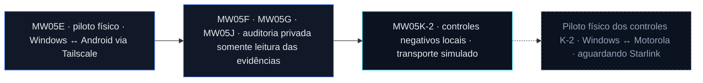

# Nexus Runtime Platform V2700

## Série Multi-WAN 05 — MW05E, MW05F, MW05G, MW05J e MW05K-2 (experimental)

[English](NEXUS_V2700_MULTIWAN_05_SERIES_EN.md) · **Português (Brasil)**

**Data de referência:** 23 de novembro de 2026

**Classificação:** documentação experimental pública; evidências brutas mantidas em caráter privado.

**Status:** piloto físico de computação remota executado (MW05E); auditoria
privada pós-piloto das evidências reportada (MW05F, MW05G, MW05J); suíte local
de controles negativos com transporte simulado reportada como aprovada
(MW05K-2). **Um novo piloto físico Windows–Motorola dos controles do MW05K-2
está pendente** até que a conexão Starlink esteja disponível.

> [!IMPORTANT]
> **Escopo.** Estes marcos se referem a ferramentas de laboratório isoladas em
> torno do caminho de computação do Nexus. Eles **não** demonstram consenso
> distribuído, execução exatamente uma vez certificada, tolerância universal a
> partições, fencing de líder, commit distribuído nem prontidão para produção.
> Nada nesta série altera o runtime da `main`.

---

### 1. Classes de evidência usadas neste relatório

| Classe | Significado |
|---|---|
| **Verificado de forma independente** | Recalculado para este relatório a partir de arquivos de evidência disponíveis ao autor da documentação. |
| **Reportado pelo operador** | Extraído da saída de terminal apresentada pelo operador. Os arquivos privados subjacentes (log e journal do servidor Android) **não** estavam disponíveis para reprocessamento independente quando este relatório foi escrito. |
| **Pendente** | Planejado, mas não executado. |

Cada número abaixo traz uma dessas classificações.

---

### 2. Visão geral dos marcos

| Marco | O que é | Ambiente | Status |
|---|---|---|---|
| MW05E | Piloto físico de computação remota | Cliente Windows ↔ servidor Android/Termux via Tailscale | Executado; relatório completo em revisão na [PR #110](https://github.com/gutembergpb27/Termux-nexus/pull/110) |
| MW05F · MW05G · MW05J | Auditoria pós-piloto, somente leitura, das evidências privadas do MW05E (saídas, vínculo com entradas, rejeições de autenticação, verificações estáticas do código) | Offline, sobre as evidências privadas | Reportada como aprovada, com limitações declaradas |
| MW05K-2 | Suíte local de controles negativos | Máquina única, transporte simulado | Reportada como aprovada |
| Piloto físico K-2 | Nova execução dos controles K-2 entre dispositivos | Windows ↔ Motorola (Android) | **Pendente** — aguardando conectividade Starlink |

Os materiais disponíveis documentam o resultado combinado das etapas de
auditoria MW05F, MW05G e MW05J (uma auditoria de passagem única que cobre do
MW05E ao MW05J), e não um detalhamento separado por etapa. Por isso, este
relatório as apresenta em conjunto.

---

### 3. MW05E — linha de base usada pela auditoria

O relatório completo do MW05E está na [PR #110](https://github.com/gutembergpb27/Termux-nexus/pull/110)
e não é repetido aqui. Esta série acrescenta uma verificação independente das
evidências do **lado cliente (Windows)**:

| Verificação | Resultado | Classe |
|---|---:|---|
| Manifesto de evidências do cliente (`SHA256SUMS`) | 1/1 arquivo OK | Verificado de forma independente |
| Registros JSONL do cliente | 96 | Verificado de forma independente |
| Ocorrências `completed` / IDs únicos de tarefas concluídas | 67 / **66** | Verificado de forma independente |
| Impressão digital SHA-256 dos IDs únicos ordenados | `dd2cb1d4672ec38fee4bfb279280757025a17497cd656c73c64cd6abfe797e5f` | Verificado de forma independente (igual ao valor reportado para os dois dispositivos) |
| Tarefas concluídas por tipo (cliente) | 50 `echo_tiny`, 5 originais dos controles negativos, 5 `matrix_8x8`, 5 `data_transform`, 1 matriz grande | Verificado de forma independente |
| Tentativas de controle negativo no cliente (assinatura alterada, segredo errado, expirada, reenvio idêntico) | 20, todas classificadas como `UNKNOWN` pelo cliente (nenhum resultado aceito) | Verificado de forma independente |
| Registros do servidor e do journal Android; hashes das saídas | Ver seção 4 | Reportado pelo operador |

O método da impressão digital é o mesmo do relatório MW05E: valores
`task_id` concluídos, sem duplicatas, ordenados, serializados em JSON
(`ensure_ascii=True`, `separators=(',', ':')`, UTF-8) e submetidos a SHA-256.

---

### 4. MW05F · MW05G · MW05J — auditoria privada das evidências

**Método.** Um script somente leitura processou, no próprio aparelho, o log do
servidor Android, o journal do servidor e o código-fonte do servidor, sem acesso
à rede e sem executar o código auditado. Ele:

1. correlacionou os registros `task` e `done` do journal pelo ID da tarefa e
   verificou que o hash da entrada (`payload_sha`) coincidia entre eles;
2. recalculou o SHA-256 em JSON canônico de cada saída **retida** e comparou
   com o `output_sha` registrado;
3. vinculou cada saída `echo` à sua entrada, recalculando o hash da entrada a
   partir do valor retornado;
4. regenerou as entradas matriciais determinísticas, confirmou o hash da
   entrada e recalculou cada produto matricial;
5. recalculou cada transformação `sum` a partir da entrada;
6. para a única saída não retida no journal, identificou a entrada pelo hash e
   verificou que o hash do produto recalculado coincidia com o `output_sha`
   registrado;
7. contou as rejeições de autenticação no log do servidor;
8. inspecionou estaticamente o tratador de requisições do servidor para
   confirmar que a verificação do envelope aparece antes da construção da
   tarefa.

**Resultados — reportados pelo operador.**

| Verificação | Resultado |
|---|---:|
| Tarefas concluídas correlacionadas entre registros `task` e `done` do journal | **66** / 66 |
| Eventos `task` ou `done` duplicados | 0 |
| Saídas retidas com SHA-256 recalculado e coincidente | **65** / 65 |
| Saídas `echo` vinculadas às entradas | **55** / 55 |
| Multiplicações matriciais recalculadas de forma independente | **5** / 5 |
| Transformações de soma recalculadas | **5** / 5 |
| Saída não retida reconstruída com hash coincidente | **1** / 1 |
| Hashes de entrada associados a mais de um hash de saída | 0 |
| Rejeições históricas de autenticação no log do servidor | **20** |

Verificação cruzada: 55 + 5 + 5 saídas retidas + 1 saída reconstruída = 66
tarefas concluídas, coerente com os tipos verificados de forma independente no
lado cliente (seção 3).

**Limitações declaradas pela própria auditoria.**

- Os registros de rejeição do servidor não trazem identificador de requisição
  nem de tarefa; por isso, as 20 rejeições **não podem ser associadas uma a
  uma** às 20 tentativas de controle negativo do cliente. Contagens iguais não
  equivalem a correlação individual.
- A verificação estática mostra a ordem das chamadas no texto do código. Ela
  **não** prova que todos os caminhos de execução falham de forma segura
  (fail-closed).
- A prontidão para produção ou para operação distribuída não foi avaliada.

---

### 5. MW05K-2 — controles negativos locais com transporte simulado

O MW05K-2 trata a primeira limitação acima em um ambiente local controlado, no
qual cada requisição inválida pode ser acompanhada individualmente.

| Verificação | Resultado | Classe |
|---|---:|---|
| Controles negativos executados | 20 | Reportado pelo operador |
| Controles negativos aprovados (requisição rejeitada conforme esperado) | **20** / 20 | Reportado pelo operador |
| Chamadas ao executor causadas por um controle negativo | **0** observadas | Reportado pelo operador |

> [!WARNING]
> O MW05K-2 foi executado **localmente, com transporte simulado**. Ele não
> mostra o mesmo comportamento entre dispositivos ou redes reais. O piloto
> físico Windows–Motorola que repetiria esses controles via Tailscale está
> **pendente** até que a conexão Starlink esteja disponível.

---

### 6. O que esta série mostra — e o que não mostra

**Sustentado, dentro do escopo de laboratório documentado:**

- 66 tarefas de computação remota concluídas cujos identificadores coincidem
  entre o cliente Windows, o servidor Android e seu journal (impressão digital
  verificada no lado cliente).
- Saídas retidas coerentes com os hashes registrados e, para tarefas `echo`,
  matriciais e de soma, coerentes com o recálculo a partir das entradas
  (reportado pelo operador).
- Em uma suíte local com transporte simulado, 20 requisições inválidas
  rejeitadas sem nenhuma chamada ao executor observada (reportado pelo
  operador).

**Não demonstrado:**

- Consenso distribuído, eleição por quórum ou fencing de líder.
- Execução exatamente uma vez certificada.
- Tolerância a partições ou comportamento sob falhas de rede arbitrárias.
- Atribuição uma a uma das 20 rejeições históricas do MW05E a tentativas
  específicas do cliente.
- Comportamento fail-closed em todos os caminhos de código do servidor.
- Prontidão para produção.

---

### 7. Próximos passos

1. Executar os controles negativos do MW05K-2 na configuração física
   Windows–Motorola quando o Starlink estiver disponível, com identificadores
   por requisição nos registros de rejeição do servidor.
2. Publicar um resumo sanitizado, com lista de hashes, da saída da auditoria,
   para que os números reportados pelo operador possam ser verificados por
   terceiros.
3. Instrumentar o caminho do tráfego de trabalho (direto ou via relay), em vez
   de inferi-lo a partir de diagnósticos anteriores.

**Privacidade:** nenhum endereço privado, segredo HMAC, identificador
individual de tarefa, caminho de dispositivo ou arquivo JSONL bruto é
publicado.

Relacionados: [Relatório Multi-WAN 01–03](NEXUS_V2700_MULTIWAN_01_03_PT.md) ·
[Índice da documentação](README.pt-BR.md)
